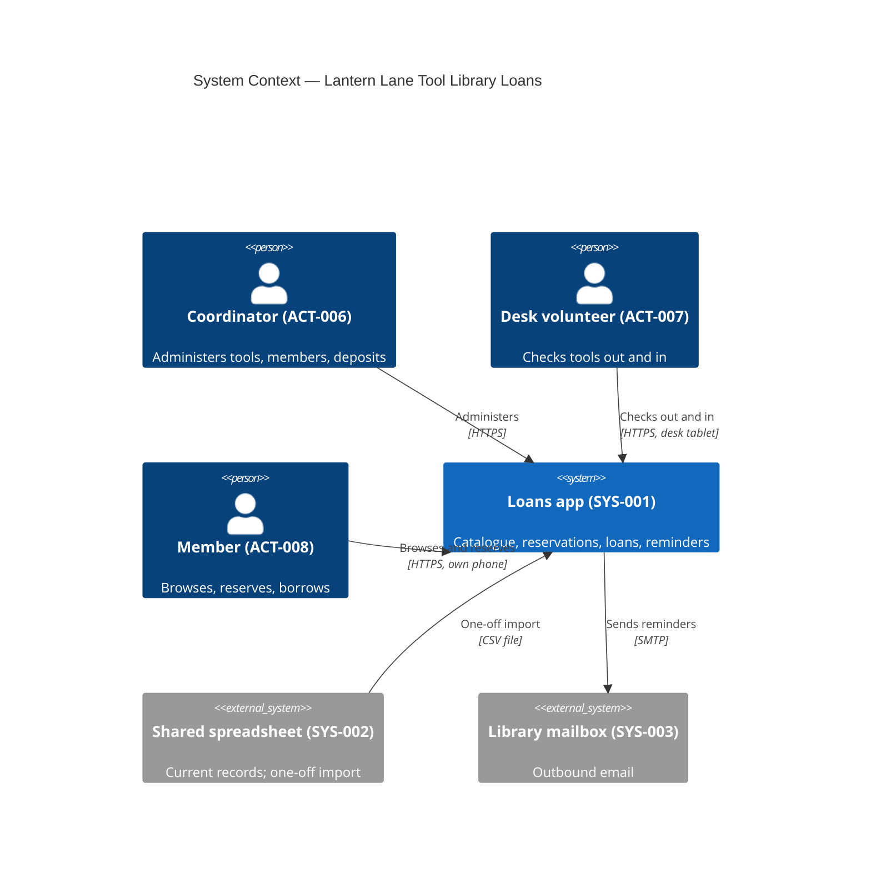

# 04 — Systems & Domain Flow: Lantern Lane Tool Library — Loans & Reservations

> Fictional demo. Lantern Lane Tool Library, its people and its data are invented for the aidev-po worked example. Items tagged Simulated come from simulated personas and are not evidence; every other tag is used as it would be in a real product, inside the fiction.

- **Product slug**: `tool-library-loans`
- **Stage**: `systems`
- **Status**: `gate-approved` (reopened and approved again by rerun RR-001 on 2026-11-12: `SYS-012` and `SYS-018` rebuilt)
- **Run ID**: `run-20261016093000-4d04`; rerun `run-20261112093000-9c09`
- **Register**: `.po/register.jsonl`
<!-- TRACE_RESERVE: item_id_prefix=SYS; trace_file=.po/traces.jsonl; fields=item_id,run,stage,agent,step,skill_versions,template_versions,upstream_ids,evidence_tag,register_refs -->

## 1. C4 Level 1 — System Context (Mermaid)

| ID | Element | Type | Owner | Boundary Notes | Evidence Tag & Source | Upstream IDs |
| --- | --- | --- | --- | --- | --- | --- |
| `SYS-001` | Loans app | System | Coordinator (product owner); build team TBD | Web app used on the desk tablet, laptops and members' phones. | `[Inferred]` | `IDEA-009`, `DEC-001` |
| `SYS-002` | Shared spreadsheet | External System | Coordinator | Source of today's members, tools and open loans; retired after import. | `[Stated — r-20261005090500-2001]` | `IDEA-001` |
| `SYS-003` | Library mailbox on the library's own domain | External System | Coordinator | Sends reminder and overdue emails as the library. | `[Stated — r-20261016090000-202b]` | `ACT-006` |

## 2. Integration Register

*Gate rule: every arrow on the context diagram has an owner and a row here. Unknown cells become questions, never guesses.*

| ID | Interface / Arrow | Direction | Data | Protocol | Owner | Volume / SLA | Failure Behaviour | Evidence Tag & Source | Upstream IDs |
| --- | --- | --- | --- | --- | --- | --- | --- | --- | --- |
| `SYS-004` | `SYS-002 -> SYS-001` | Inbound | Members, tools, open loans | CSV export, once | Coordinator | One import of about 310 members and 400 tools | Rows that fail validation are listed for the coordinator to fix by hand; nothing is half-imported. | `[Assumed — r-20261005104004-200f]` | `SYS-001`, `SYS-002` |
| `SYS-005` | `SYS-001 -> SYS-003` | Outbound | Reminder, overdue and reservation emails | SMTP | Coordinator | About 250 emails a month at the summer peak of 120 loans | Retry three times over an hour, then show the failure on the coordinator's dashboard. | `[Assumed — r-20261016113001-2030; volume Inferred from r-20261016090100-202c]` | `SYS-001`, `SYS-003` |

## 3. C4 Level 2 — Container Overview (Only If Needed)

| ID | Container | Responsibility | Key Interfaces | Evidence Tag & Source | Upstream IDs |
| --- | --- | --- | --- | --- | --- |
| `SYS-006` | `N/A` | One web app and its database; no separate deployable parts affect scope or cost. | `SYS-004`, `SYS-005` | `[Inferred]` | `SYS-001` |

## 4. Process EventStorming Flow (Strawman Event Timeline)

| ID | Step | Actor | Command | Aggregate / Invariant | Domain Event | Policy / Reaction | External System | Evidence Tag & Source | Upstream IDs |
| --- | --- | --- | --- | --- | --- | --- | --- | --- | --- |
| `SYS-007` | 1 | `ACT-008` | `ReserveTool` | Tool: at most one active reservation | `ToolReserved` | — | — | `[Inferred]` | `ACT-011`, `SYS-001` |
| `SYS-008` | 2 | System | `ReleaseReservation` | Reservation: held 48 hours | `ReservationReleased` | Whenever `ToolReserved` is not collected within 48 hours, then `ReleaseReservation` and email the member (automatic, DEC-004). | `SYS-003` | `[Stated — r-20261016113000-202f]` | `SYS-007` |
| `SYS-009` | 3 | `ACT-007` | `CheckOutTool` | Loan: a power tool needs a deposit recorded | `LoanStarted` | — | — | `[Stated — r-20261005090900-2005]` | `ACT-010`, `SYS-001` |
| `SYS-010` | 4 | System | `SendReminder` | Loan: due seven days after check-out | `ReminderSent` | Whenever a loan is due tomorrow, then `SendReminder`; whenever it is one day overdue, then `SendOverdueNotice` (automatic). | `SYS-003` | `[Inferred]` | `SYS-009`, `AUD-010` |
| `SYS-011` | 5 | `ACT-007` | `CheckInTool` | Loan: late if returned after the due date | `LoanReturned`, `LateReturnRecorded` | — | — | `[Inferred]` | `ACT-010`, `SYS-009` |
| `SYS-012` | 6 | System, then `ACT-006` | `FlagMemberForReview` | Member: count of late returns in the last 12 months | `MemberFlaggedForReview` | Whenever the third `LateReturnRecorded` in 12 months is recorded for a member, then `FlagMemberForReview`. The system never suspends anyone by itself: only the coordinator decides on a suspension, after speaking to the member. | — | `[Stated — r-20261112090500-2069]` | `IDEA-005`, `ACT-009`, `SYS-011` |

## 5. EventStorming Hotspots (Workshop Agenda Inputs & Register Items)

| ID | Hotspot | Impacted Step / System | Linked Register ID | Upstream IDs |
| --- | --- | --- | --- | --- |
| `SYS-013` | The spreadsheet has duplicate member rows; who merges them before import? | `SYS-004` | `r-20261016113002-2031` | `SYS-004` |
| `SYS-014` | Some members' email addresses are out of date and will bounce. | `SYS-005` | `r-20261016113003-2032` | `SYS-005` |

## 6. Glossary & Bounded Contexts

| ID | Term | Bounded Context | Canonical Definition | Avoid / Ambiguous Synonyms | Evidence Tag & Source | Upstream IDs |
| --- | --- | --- | --- | --- | --- | --- |
| `SYS-015` | Loan | Lending | A tool checked out to one member, due back seven days later unless the desk agrees longer. | Booking, hire | `[Stated — inputs/house-rules.md rule 2]` | `SYS-009` |
| `SYS-016` | Reservation | Lending | A hold on one tool for one member for up to 48 hours. | Booking, request | `[Stated — r-20261016113000-202f]` | `SYS-007`, `SYS-008` |
| `SYS-017` | Late return | Lending | A loan checked in after the end of its due date. | Overdue (an open loan past its due date) | `[Inferred]` | `SYS-011` |
| `SYS-018` | Suspension | Membership | A period of up to 30 days when a member cannot borrow, set and lifted only by the coordinator after a review. Never automatic. | Ban, block, automatic suspension | `[Stated — r-20261112090500-2069]` | `SYS-012` |

## 7. Stage Exit Criteria (Given/When/Then)

- `AC-SYS-001`: Given the library mailbox rejects a send, When the system has retried three times, Then the coordinator sees the failed email on the dashboard with the member and the reason.

## 8. Decision Sheet (Locked)

| Decision ID | Choice | Who Decided | Why | Register ID |
| --- | --- | --- | --- | --- |
| `DEC-004` | Reservations are held 48 hours, then released automatically. | `user` | Long enough for a weekend; short enough that a tool is not tied up. | `r-20261016145000-2034` |

## 9. Parked Items & Explicit Non-Goals

| Park ID | Item | Why It Can Wait | Revisit Trigger | Register ID |
| --- | --- | --- | --- | --- |
| `PARK-004` | Barcode or QR labels on tools | Volunteers pick tools by name today; labelling 400 tools is a project of its own. | The median check-out takes more than 2 minutes in the first month. | `r-20261016113004-2033` |

## Assumptions and open questions

=== REGISTER REQUESTS ===
[QUESTION: How long should a reservation be held? Recommend: 48 hours, then release it automatically.]
[ASSUMPTION: If an email fails to send, retrying three times and then showing it to the coordinator is enough.]
[QUESTION: Who merges duplicate members before the import? Recommend: the coordinator, before import.]
[ASSUMPTION: Some members' email addresses are out of date and will bounce.]
[QUESTION: Should tools get barcode labels in Release 1? Recommend: no; park.]
=== END REGISTER REQUESTS ===
