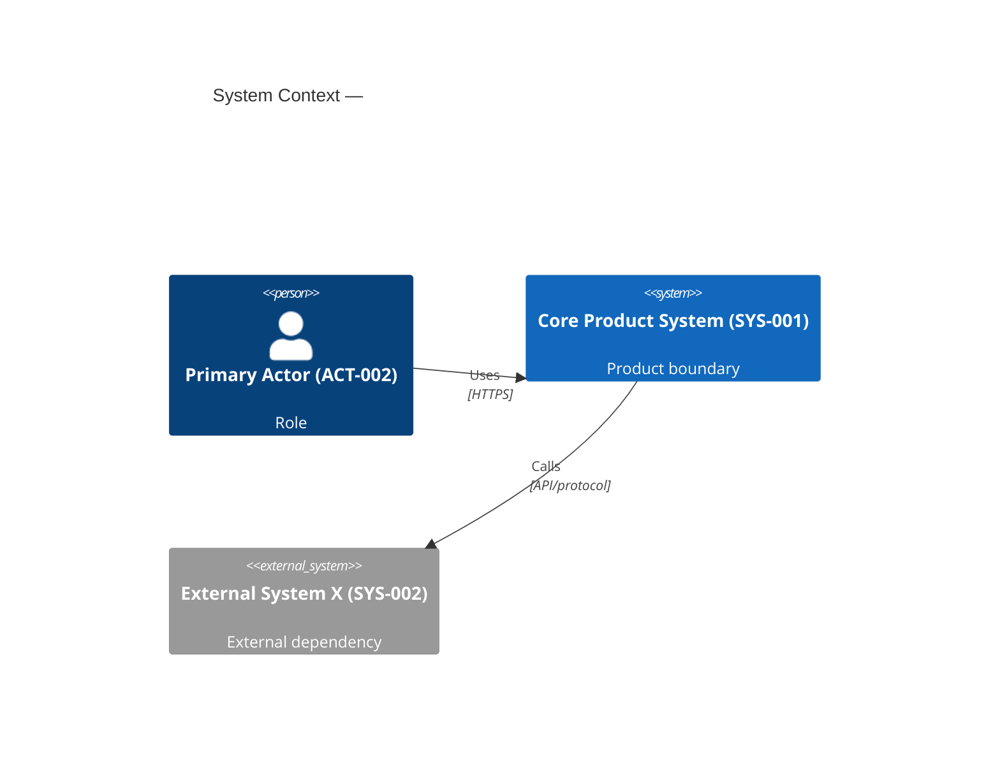

# 04 — Systems & Domain Flow: <Product Name>

- **Product slug**: `<slug>`
- **Stage**: `systems`
- **Status**: `draft` | `gate-approved`
- **Run ID**: `<run-id>`
- **Register**: `.po/register.jsonl`
<!-- TRACE_RESERVE: item_id_prefix=SYS; trace_file=.po/traces.jsonl; fields=item_id,run,stage,agent,step,skill_versions,template_versions,upstream_ids,evidence_tag,register_refs -->

## 1. C4 Level 1 — System Context (Mermaid)

*Note: For Shravi client work, include the `aidev-platform` contract as a known external system.*

| ID | Element | Type (System / Actor / External System) | Owner | Boundary Notes | Evidence Tag & Source | Upstream IDs |
| --- | --- | --- | --- | --- | --- | --- |
| `SYS-001` | Core Product System | System | Product Team | ... | `[Inferred — ...]` | `IDEA-008` |
| `SYS-002` | External System X | External System | ... | ... | `[Stated / Assumed — ...]` | `ACT-001` |

## 2. Integration Register

*Gate rule: Every arrow on the context diagram MUST have an owner and a row here. Unknown cells become `[QUESTION: ...]` entries — never guesses.*

| ID | Interface / Arrow | Direction (`Inbound` / `Outbound` / `Bidirectional`) | Data | Protocol | Owner | Volume / SLA | Failure Behaviour | Evidence Tag & Source | Upstream IDs |
| --- | --- | --- | --- | --- | --- | --- | --- | --- | --- |
| `SYS-003` | `SYS-001 -> SYS-002` | Outbound | ... | HTTPS/JSON | `<owner>` | `<req/day or unknown -> r-...>` | Timeout / retry / fallback | `[Stated / Assumed — ...]` | `SYS-001`, `SYS-002` |

## 3. C4 Level 2 — Container Overview (Only If Needed for Scope / Risk)

| ID | Container | Responsibility | Key Interfaces | Evidence Tag & Source | Upstream IDs |
| --- | --- | --- | --- | --- | --- |
| `SYS-004` | `N/A` or Container | ... | ... | ... | `SYS-001` |

## 4. Process EventStorming Flow (Strawman Event Timeline)

| ID | Step | Actor (`ACT-NNN`) | Command (Imperative) | Aggregate / Invariant | Domain Event (Past Tense) | Policy / Reaction | External System | Evidence Tag & Source | Upstream IDs |
| --- | --- | --- | --- | --- | --- | --- | --- | --- | --- |
| `SYS-005` | 1 | `ACT-002` | `Submit...` | `<invariant>` | `...Submitted` | Whenever `...Submitted`, then `...` | `-` | `[Inferred / Assumed — ...]` | `ACT-002`, `SYS-001` |

## 5. EventStorming Hotspots (Workshop Agenda Inputs & Register Items)

| ID | Hotspot | Impacted Step / System | Linked Register ID | Upstream IDs |
| --- | --- | --- | --- | --- |
| `SYS-006` | ... | `SYS-005` | `r-...` | `SYS-005` |

## 6. Glossary & Bounded Contexts

| ID | Term | Bounded Context | Canonical Definition (Shared by FSD & Code) | Avoid / Ambiguous Synonyms | Evidence Tag & Source | Upstream IDs |
| --- | --- | --- | --- | --- | --- | --- |
| `SYS-007` | `<Domain Term>` | `<Context>` | ... | ... | `[Stated / Inferred — ...]` | `SYS-005` |

## 7. Stage Exit Criteria (Given/When/Then)

- `AC-SYS-001`: Given `<system boundary/event>`, When `<trigger or external failure>`, Then `<observable behaviour>`.

## 8. Decision Sheet (Locked)

| Decision ID | Choice | Who Decided | Why | Register ID |
| --- | --- | --- | --- | --- |
| `DEC-004` | ... | `user` / `po` | ... | `r-...` |

## 9. Parked Items & Explicit Non-Goals

| Park ID | Item | Why It Can Wait | Revisit Trigger | Register ID |
| --- | --- | --- | --- | --- |
| `PARK-004` | ... | ... | `<concrete event/metric>` | `r-...` |

## Assumptions and open questions

=== REGISTER REQUESTS ===
None.
=== END REGISTER REQUESTS ===
